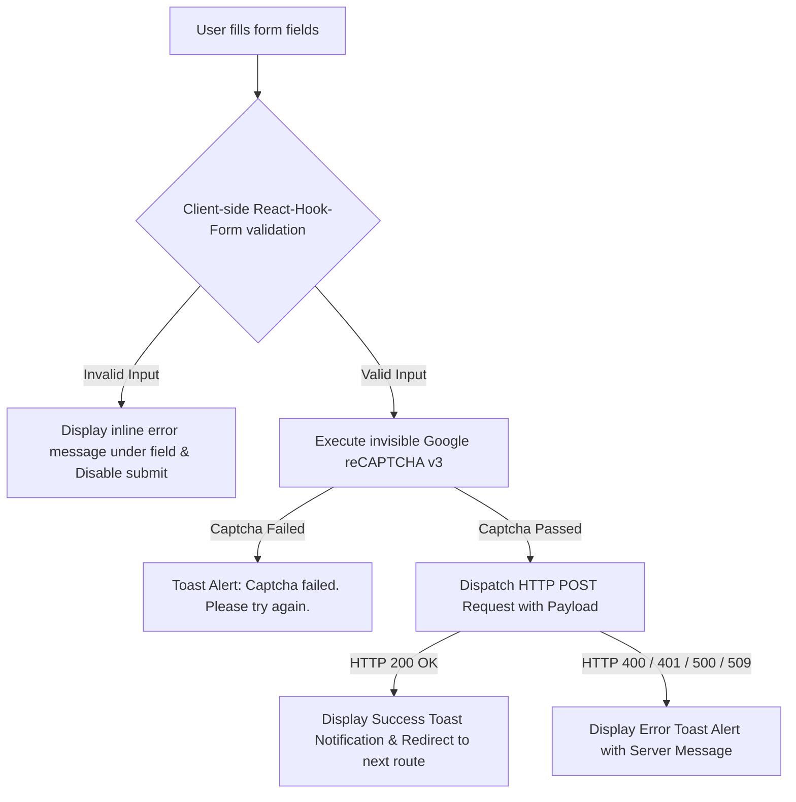

# Field Validation Matrix - Field Force Connect
**Target Application:** [https://test.fieldforceconnect.com/](https://test.fieldforceconnect.com/)  
**Document Version:** 1.0.0  
**Prepared For:** Nimap Machine Test  
**Author:** QA Engineering Team  
**Date:** November 2026  

---

## 1. Overview
This document specifies the validation criteria, data types, constraints, boundary limits, regex patterns, positive input examples, negative input examples, and exact error messages for each field across the 4 core authentication modules:
1. **Sign Up (`/auth/register`)**
2. **Forgot Password (`/auth/forget-password`)**
3. **Sign with OTP (`/auth/otp-verification`)**
4. **Login (`/auth/login`)**

---

## 2. Module 1: Sign Up (`/auth/register`)

| Field Name | Control Type | Required? | Min / Max Length | Validation Rules & Patterns | Positive Test Inputs | Negative Test Inputs | Triggered Error Message |
|---|---|:---:|:---:|---|---|---|---|
| **Company Name** (`companyName`) | Text Input | **Yes** | 1 - 100 chars | Cannot be empty or whitespace only. `trim().length > 0`. | `Nimap Infotech`, `Tech Solutions Pvt Ltd` | `""` (Empty), `   ` (Spaces only) | `Name is required` `Name cannot be empty` |
| **Contact Person Name** (`contactPersonName`) | Text Input | **Yes** | 1 - 60 chars | Cannot be empty or whitespace only. `trim().length > 0`. Alphabets & spaces allowed. | `Aarav Mehta`, `John Doe` | `""` (Empty), `   ` (Spaces only) | `Contact Person Name is required` `Contact Person Name cannot be empty` |
| **Mobile Number** (`mobile`) | Tel / Number Input | **Yes** | 6 - 15 digits | Numeric only (`0-9`). Default country dial code: `+91`. Max length 15. | `9876543210`, `8123456789` | `< 6 digits` (e.g. `12345`), Alphabets (`abcde`), Special chars (`@#$%^`) | `Enter a valid 6-15 digit mobile number` Non-numeric keystrokes prevented |
| **Country Dial Code** (`country`) | Dropdown / Select | **Yes** | N/A | Must be a valid country ID/code from API (`/api/Account/GetCountryList`). Default: `+91 (India, ID: 101)`. | `+91 (India)`, `+1 (USA)`, `+44 (UK)` | Unselected / Invalid ID | `Country dial code is required` |
| **Email ID** (`email`) | Text Input (Email) | **Yes** | 5 - 100 chars | Regex pattern: `/^[^\s@]+@[^\s@]+\.[^\s@]{2,}$/`. Must have standard email format. | `rahul@nimapinfotech.com`, `qa.lead@example.org` | `rahul@`, `rahul.com`, `@domain.com`, `rahul@domain`, `user name@test.com` | `Email is required` `Enter a valid email ID` |
| **Timezone** (`timezone`) | Select Dropdown | **Yes** | N/A | Must select a valid timezone object from list. Default: ID 104 (`Asia/Kolkata`). | `(UTC+05:30) Chennai, Kolkata, Mumbai, New Delhi` | Unselected / Cleared | `Time Zone is required` |
| **Currency** (`currency`) | Select Dropdown | **Yes** | N/A | Must select a valid currency ID from company settings. Default: ID 1 (`₹ - INR`). | `₹ - INR`, `$ - USD`, `€ - EUR` | Unselected / Cleared | `Currency is required` |

---

## 3. Module 2: Forgot Password (`/auth/forget-password`)

| Field Name | Control Type | Required? | Min / Max Length | Validation Rules & Patterns | Positive Test Inputs | Negative Test Inputs | Triggered Error Message |
|---|---|:---:|:---:|---|---|---|---|
| **Email ID / Mobile No** (`emailOrMob`) | Text Input | **Yes** | 6 - 100 chars | Must match either: 1. Email Regex: `/^[^\s@]+@[^\s@]+\.[^\s@]{2,}$/` OR 2. Mobile Regex: `/^\d{6,15}$/` | **Email:** `user@example.com` **Mobile:** `9876543210`, `919876543210` | `""` (Empty), `abc`, `user@`, `12345` (too short), `1234567890123456` (too long), `abc@com` | `Email or mobile number is required` `Enter a valid email or 6-15 digit mobile number` |

---

## 4. Module 3: Sign with OTP (`/auth/otp-verification`)

| Field Name | Control Type | Required? | Min / Max Length | Validation Rules & Patterns | Positive Test Inputs | Negative Test Inputs | Triggered Error Message |
|---|---|:---:|:---:|---|---|---|---|
| **OTP Digits (Box 1-4)** (`otp`) | 4-Digit Pin Input | **Yes** | Exactly 4 digits | Digits `0-9` only. Must fill all 4 individual character slots. Auto-focus shifts to next slot. | `1234`, `5678`, `0000` | `< 4 digits` (e.g. `1`, `12`, `123`), Letters (`abcd`), Symbols (`!@#$`), Incorrect OTP | `Please enter all 4 digits of OTP.` `Invalid OTP.` `OTP verification failed.` |
| **Resend OTP** (Action Trigger) | Hyperlink / Button | N/A | Cooldown 30s-60s | Clickable only when countdown timer reaches `00:00`. | Click after timer reaches `00:00` | Click during active countdown timer | Button is disabled; shows remaining countdown time |

---

## 5. Module 4: Login (`/auth/login`)

| Field Name | Control Type | Required? | Min / Max Length | Validation Rules & Patterns | Positive Test Inputs | Negative Test Inputs | Triggered Error Message |
|---|---|:---:|:---:|---|---|---|---|
| **Email ID / Mobile No** (`username`) | Text Input | **Yes** | 6 - 100 chars | Trimmed value must match either: 1. Email: `/^[^\s@]+@[^\s@]+\.[^\s@]{2,}$/` OR 2. Mobile: `/^\d{6,15}$/` | **Email:** `admin@fieldforce.com` **Mobile:** `9876543210` | `""` (Empty), `admin@`, `98765` (< 6 digits), `user@xyz`, `plain_username` | `Email or mobile number is required` `Enter a valid email or 6-15 digit mobile number` |
| **Password** (`password`) | Password Input (Masked) | **Yes** | 8 - 12 chars | 1. Required 2. No leading or trailing spaces (`val.trim() === val`) 3. Min length: 8 chars 4. Max length: 12 chars | `Nimap@2026`, `Admin@123`, `P@ssw0rd` | `""` (Empty), ` 12345678` (leading space), `12345678 ` (trailing space), `1234567` (7 chars), `1234567890123` (13 chars) | `Password is required` `Password cannot start or end with spaces` `Password must be at least 8 characters long` `Password cannot exceed 12 characters` |

---

## 6. Summary of Form Submission Behavior

