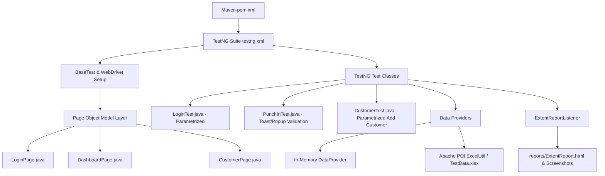

# Field Force Connect - Comprehensive QA Machine Test Solution
*(Manual Testing + Automation Testing + Postman API Testing)*

**Target Application:** [https://test.fieldforceconnect.com/](https://test.fieldforceconnect.com/)  
**Organization:** Nimap Infotech QA Technical Evaluation  
**Framework Version:** 1.0.0  
**Language & Engine:** Java 17 (Pure Java Architecture, Maven, Selenium WebDriver 4, TestNG)  

---

## 📋 Table of Contents
1. [Project Overview & Architecture](#project-overview--architecture)
2. [Module Deliverables Summary](#module-deliverables-summary)
   - [Part 1: Automation Testing (Selenium + TestNG)](#part-1-automation-testing-selenium--testng)
   - [Part 2: Manual Testing (Test Cases, Validations, Bugs)](#part-2-manual-testing)
   - [Part 3: Postman API Testing (Environments, Tokens, Requests)](#part-3-postman-api-testing)
3. [Technology Stack](#technology-stack)
4. [Project Directory Layout](#project-directory-layout)
5. [Prerequisites & Environment Setup](#prerequisites--environment-setup)
6. [How to Execute Automation Tests](#how-to-execute-automation-tests)
7. [Reporting & Test Artifacts](#reporting--test-artifacts)
8. [Postman API Execution Guide](#postman-api-execution-guide)
9. [GitHub Repository Setup & Push Guide](#github-repository-setup--push-guide)

---

## 1. Project Overview & Architecture
This repository delivers an end-to-end, enterprise-grade Quality Assurance testing suite designed specifically for the **Field Force Connect** application per the Nimap QA Machine Test requirements.

### Architecture Highlights
- **Pure Java Implementation:** Built strictly with Java 17 and Maven without external scripting dependencies.
- **Page Object Model (POM):** Complete separation of page element locators, explicit synchronization logic, and test assertions.
- **Dual Parametrization Support:**
  - **In-line TestNG `@DataProvider`:** Rapid execution with multi-dataset test vectors.
  - **Apache POI Excel Data-Driven Engine:** Externalized test matrices read directly from `.xlsx` files.
- **Automated Driver Management:** Leverages `WebDriverManager` for zero-configuration browser binary resolution.
- **Comprehensive Reporting:** Integrated **ExtentReports 5** with execution logs, test status badges, and automated Base64 failure screenshots.



---

## 2. Module Deliverables Summary

### Part 1: Automation Testing (Selenium + TestNG)
1. **Automate Login Journey (by Parametrization & Validation):**
   - Implemented in [`LoginTest.java`](file:///c:/Users/Admin/OneDrive/Desktop/New%20folder/src/test/java/com/fieldforce/tests/LoginTest.java).
   - Validates multiple datasets: Valid credentials, Invalid password, Unregistered user, Invalid email/phone syntax, and Blank fields.
   - Verifies dashboard redirection, tokens, and inline/toast error messages.
2. **Verify Toast / Popup Message After PunchIn:**
   - Implemented in [`PunchInTest.java`](file:///c:/Users/Admin/OneDrive/Desktop/New%20folder/src/test/java/com/fieldforce/tests/PunchInTest.java).
   - Authenticates session, navigates to dashboard, clicks **Punch In**, accepts confirmation modal if prompted, and asserts the toast/popup notification.
3. **Add Customer (using Parametrization & Validation):**
   - Implemented in [`CustomerTest.java`](file:///c:/Users/Admin/OneDrive/Desktop/New%20folder/src/test/java/com/fieldforce/tests/CustomerTest.java).
   - Parametrizes customer attributes (Customer Name, Contact Person, Mobile, Email, Address).
   - Fills form drawer, submits, and asserts confirmation toast (`Customer Added Successfully`).

### Part 2: Manual Testing
- **Test Cases:** [`MANUAL_TEST_CASES.md`](file:///c:/Users/Admin/OneDrive/Desktop/New%20folder/MANUAL_TEST_CASES.md)
  - 40 detailed test cases covering Sign Up (12), Forgot Password (8), Sign with OTP (8), and Login (12).
- **Field Validation Matrix:** [`FIELD_VALIDATION_MATRIX.md`](file:///c:/Users/Admin/OneDrive/Desktop/New%20folder/FIELD_VALIDATION_MATRIX.md)
  - Detailed constraints, regex patterns, boundary limits, positive/negative inputs, and exact error messages for every field.
- **Bug Reports:** [`BUG_REPORT.md`](file:///c:/Users/Admin/OneDrive/Desktop/New%20folder/BUG_REPORT.md)
  - 6 formal bug reports documenting password length limitations, missing password visibility toggles, OTP paste defects, and UX flaws.

### Part 3: Postman API Testing
- **Postman Environment:** [`Postman/FieldForceConnect.postman_environment.json`](file:///c:/Users/Admin/OneDrive/Desktop/New%20folder/Postman/FieldForceConnect.postman_environment.json)
  - Configures `baseUrl`, `validUsername`, `validPassword`, dynamic `authToken`, `newCustomerName`, etc.
- **Postman Collection:** [`Postman/FieldForceConnect.postman_collection.json`](file:///c:/Users/Admin/OneDrive/Desktop/New%20folder/Postman/FieldForceConnect.postman_collection.json)
  - Covers Valid Login (extracts `authToken`), Invalid Login, GET Country List, GET Customer Statuses, and POST Add Customer.
- **Postman Execution Guide:** [`Postman/POSTMAN_API_TESTING_GUIDE.md`](file:///c:/Users/Admin/OneDrive/Desktop/New%20folder/Postman/POSTMAN_API_TESTING_GUIDE.md).

---

## 3. Technology Stack

| Component | Technology | Version |
|---|---|---|
| **Language** | Java | OpenJDK 17 |
| **Build & Dependency Management** | Apache Maven | 3.9+ |
| **Automation Engine** | Selenium WebDriver | 4.25.0 |
| **Test Runner & Framework** | TestNG | 7.10.2 |
| **Driver Management** | Boni Garcia WebDriverManager | 5.9.2 |
| **HTML Reporting** | ExtentReports 5 (AventStack) | 5.1.2 |
| **Excel Data Engine** | Apache POI & POI-OOXML | 5.2.5 |
| **API Testing Engine** | Postman / Newman CLI | v2.1.0 Collection Schema |

---

## 4. Project Directory Layout

```
.
├── pom.xml                                   # Maven Dependencies & Surefire Configuration
├── testng.xml                                # TestNG Suite Runner
├── README.md                                 # Master Project Documentation
├── MANUAL_TEST_CASES.md                      # Comprehensive Manual Test Cases Template
├── FIELD_VALIDATION_MATRIX.md                # Field Validation Specifications
├── BUG_REPORT.md                             # Formal Bug Reports
├── Postman/
│   ├── FieldForceConnect.postman_collection.json   # Postman API Collection (v2.1.0)
│   ├── FieldForceConnect.postman_environment.json  # Postman Environment Variables
│   └── POSTMAN_API_TESTING_GUIDE.md                # Postman & Newman Execution Guide
├── src/
│   ├── main/
│   │   ├── java/com/fieldforce/
│   │   │   ├── base/
│   │   │   │   └── BaseTest.java             # WebDriver setup, lifecycle & screenshot capture
│   │   │   ├── config/
│   │   │   │   └── ConfigReader.java         # Properties reader
│   │   │   ├── pages/
│   │   │   │   ├── LoginPage.java            # Login page object
│   │   │   │   ├── DashboardPage.java        # Dashboard & PunchIn page object
│   │   │   │   └── CustomerPage.java         # Customer management & Add Customer page object
│   │   │   └── utils/
│   │   │       ├── ExcelUtil.java            # Apache POI Excel reader/generator
│   │   │       ├── ExtentManager.java        # ExtentReports 5 singleton instance
│   │   │       ├── ExtentReportListener.java # TestNG listener for HTML reports & screenshots
│   │   │       └── WaitUtils.java            # Explicit synchronization utilities
│   │   └── resources/
│   │       └── config.properties             # Environment configuration (URL, browser, timeouts)
│   └── test/
│       ├── java/com/fieldforce/
│       │   ├── tests/
│       │   │   ├── LoginTest.java            # Parametrized Login journey tests
│       │   │   ├── PunchInTest.java          # PunchIn toast/popup validation tests
│       │   │   └── CustomerTest.java         # Parametrized Add Customer tests
│       │   └── utils/
│       │       └── GenerateTestDataExcel.java# Runner to generate sample Excel test data
│       └── resources/
│           ├── testng.xml                    # Test suite definition
│           └── testdata/
│               ├── LoginTestData.xlsx        # Excel test dataset for Login
│               └── CustomerTestData.xlsx     # Excel test dataset for Customer
```

---

## 5. Prerequisites & Environment Setup

1. **Java Development Kit (JDK):** JDK 17 or higher installed. Verify with:
   ```bash
   java -version
   ```
2. **Apache Maven:** Maven 3.8+ installed. Verify with:
   ```bash
   mvn -version
   ```
3. **Browser:** Google Chrome (latest version).

---

## 6. How to Execute Automation Tests

### A. Run Entire Test Suite (Default Headless Mode)
```bash
mvn clean test
```

### B. Run in Visible (Headed) Browser Mode
To watch the browser actions live on screen:
```bash
mvn clean test -Dheadless=false
```

### C. Run a Specific Test Class
- **Run Login Journey:**
  ```bash
  mvn test -Dtest=LoginTest
  ```
- **Run Punch In Journey:**
  ```bash
  mvn test -Dtest=PunchInTest
  ```
- **Run Add Customer Journey:**
  ```bash
  mvn test -Dtest=CustomerTest
  ```

### D. Generate Sample Excel Test Data Files
To regenerate the Apache POI Excel test data files:
```bash
mvn test-compile exec:java "-Dexec.mainClass=com.fieldforce.utils.GenerateTestDataExcel" "-Dexec.classpathScope=test"
```

---

## 7. Reporting & Test Artifacts

### ExtentReports 5 HTML Report
After running the tests, open the generated HTML report in any web browser:
- **Location:** `reports/ExtentReport.html`
- **Features:**
  - Executive summary dashboard with Pass/Fail/Skip charts.
  - Granular timestamps and log statements per test step.
  - Automated Base64 embedded screenshots for any failed assertions.
  - Environment and system runtime details.

---

## 8. Postman API Execution Guide
1. Launch **Postman**.
2. Click **Import** and select:
   - `Postman/FieldForceConnect.postman_collection.json`
   - `Postman/FieldForceConnect.postman_environment.json`
3. In the top-right environment dropdown, select **FieldForceConnect_Test_Environment**.
4. Open the Collection Runner and click **Run Field Force Connect - API Automation Suite**.
5. All requests will execute sequentially:
   - Request 1 logs in and captures the `authToken`.
   - Request 2 validates invalid credentials rejection.
   - Request 3 & 4 verify master configuration GET APIs.
   - Request 5 creates a customer using the extracted authorization token.

---

## 9. GitHub Repository Setup & Push Guide
To push this project to your GitHub account:

```bash
# 1. Initialize Git repository
git init

# 2. Add all files
git add .

# 3. Commit files
git commit -m "feat: Nimap QA Machine Test - Automation (Selenium+TestNG), Manual Test Cases, and Postman API Suite"

# 4. Set default branch to main
git branch -M main

# 5. Link your GitHub remote repository (replace with your repo URL)
git remote add origin https://github.com/<your-username>/<your-repo-name>.git

# 6. Push to GitHub
git push -u origin main
```
